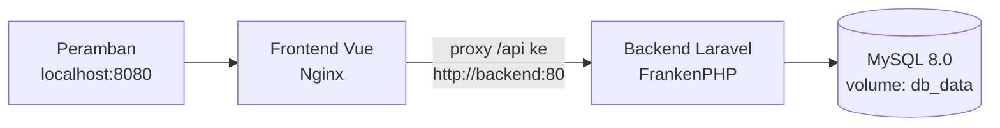

# Inventaris Lab


Sistem pencatatan peralatan laboratorium berbasis web: backend **Laravel**
yang menyediakan REST API bertoken, frontend **Vue** untuk mengelola data,
dan seluruh layanan yang diorkestrasi dengan **Docker Compose** dalam tiga
service. Proyek ini disusun sebagai tugas Materi Uji.

## Fitur

- **Autentikasi token** dengan Laravel Sanctum: hanya login yang bersifat
  publik, seluruh endpoint lain memerlukan Bearer token.
- **CRUD lengkap** untuk satu resource, `equipments`: tampil, tambah, ubah,
  dan hapus peralatan laboratorium, dengan validasi pada lapisan
  Form Request.
- **Balasan JSON yang konsisten** (`{success, message, data}`) dengan kode
  status yang benar: `200`, `201` untuk data baru, `401` tanpa token,
  `404` untuk data yang tidak ditemukan, dan `422` untuk validasi gagal.
- **Frontend Vue terintegrasi penuh**: login, daftar alat, formulir
  tambah/ubah, hapus dengan konfirmasi, serta pesan galat `401`/`422`
  yang tampil langsung di halaman.
- **Satu perintah untuk menjalankan semuanya**: `docker compose up -d --build`.
- **Data persisten** melalui named volume, dan **FrankenPHP** sebagai server
  aplikasi backend (nilai tambahan).

## Teknologi

| Lapisan   | Teknologi                                              |
|-----------|--------------------------------------------------------|
| Backend   | Laravel 13, Laravel Sanctum, FrankenPHP 1.13.3-php8.4  |
| Frontend  | Vue 3, Vite, axios, Nginx 1.27.4-alpine                 |
| Basis data| MySQL 8.0.46                                           |
| Orkestrasi| Docker Compose (3 service, 2 named volume)             |
| Pengujian | Postman Collection, curl                               |

## Arsitektur



| Service  | Image                          | Port host | Peran                                              |
|----------|--------------------------------|-----------|----------------------------------------------------|
| `db`     | `mysql:8.0.46`                 | —         | Basis data, healthcheck `mysqladmin ping`          |
| `backend`| `dunglas/frankenphp:1.13.3-php8.4` | `8000` | REST API, autentikasi Sanctum, akses basis data    |
| `frontend`| `nginx:1.27.4-alpine` (build `node:22.20.0-alpine`) | `8080` | Antarmuka Vue, proxy `/api` ke service `backend` |

Komunikasi antarlayanan memakai **nama service Docker**, bukan alamat IP
mesin: backend terhubung ke basis data dengan `DB_HOST=db`, dan frontend
terhubung ke backend lewat proxy Nginx. Peramban hanya memanggil origin
frontend sendiri. Seluruh image dasar dipin pada versi yang jelas, bukan
`latest`.

Alur data: formulir Vue → axios dengan header
`Authorization: Bearer <token>` → Nginx meneruskan `/api/*` ke service
`backend` → route `api.php` (middleware `auth:sanctum`, kecuali login) →
`EquipmentController` → validasi `FormRequest` → model `Equipment` →
tabel `equipment` di MySQL.

## Memulai

### Prasyarat

- Docker dan Docker Compose v2.

### Menjalankan

```bash
cp .env.example .env
# Isi DB_PASSWORD dan DB_ROOT_PASSWORD di .env dengan nilai Anda sendiri.
# APP_KEY boleh dikosongkan: entrypoint backend membuatnya dan menyimpannya
# di volume backend_storage saat pertama kali berjalan.

docker compose up -d --build
docker compose ps
```

| Akses            | URL                            |
|------------------|--------------------------------|
| Frontend Vue     | http://localhost:8080          |
| API (butuh token)| http://localhost:8000/api      |

### Akun demo

Akun berikut dibuat otomatis oleh seeder dan hanya untuk demo lokal:

| Email          | Password    |
|----------------|-------------|
| admin@lab.test | password123 |

> Tidak ada endpoint registrasi publik, sesuai ketentuan soal: seluruh
> endpoint selain login hanya dapat diakses dengan token.

### Menghentikan

```bash
docker compose down      # kontainer berhenti, data tetap tersimpan
docker compose down -v   # HATI-HATI: menghapus volume beserta datanya
```

## Referensi API

### Autentikasi

| Metode | Endpoint       | Auth   | Keterangan                              |
|--------|----------------|--------|-----------------------------------------|
| POST   | `/api/login`   | —      | Mengembalikan `data.token` (Sanctum)    |
| POST   | `/api/logout`  | Bearer | Menghapus token yang sedang dipakai     |
| GET    | `/api/user`    | Bearer | Profil pengguna yang sedang login       |

### Resource `equipments`

| Metode | Endpoint                 | Auth   | Keterangan                    |
|--------|--------------------------|--------|-------------------------------|
| GET    | `/api/equipments`        | Bearer | Tampil semua                  |
| POST   | `/api/equipments`        | Bearer | Tambah, balasan `201`         |
| GET    | `/api/equipments/{id}`   | Bearer | Tampil satu, `404` bila tidak ada |
| PUT    | `/api/equipments/{id}`   | Bearer | Ubah                          |
| DELETE | `/api/equipments/{id}`   | Bearer | Hapus                         |

### Validasi

| Kolom       | Aturan                                                        |
|-------------|---------------------------------------------------------------|
| `name`      | Wajib                                                         |
| `code`      | Wajib, unik                                                   |
| `category`  | `Komputer`, `Jaringan`, `Audio Visual`, `Perkakas`, `Lainnya` |
| `quantity`  | Integer, minimal `0`                                           |
| `condition` | `baik`, `rusak_ringan`, `rusak_berat`, `perawatan`            |
| `location`  | Wajib                                                         |
| `description`| Opsional                                                     |

### Contoh permintaan

```bash
# Login
curl -s -X POST http://localhost:8000/api/login \
  -H 'Accept: application/json' -H 'Content-Type: application/json' \
  -d '{"email":"admin@lab.test","password":"password123"}'

# Tampil semua (ganti TOKEN dengan token dari login)
curl -s http://localhost:8000/api/equipments \
  -H "Authorization: Bearer TOKEN"

# Tambah (balasan 201)
curl -s -X POST http://localhost:8000/api/equipments \
  -H 'Accept: application/json' -H 'Content-Type: application/json' \
  -H "Authorization: Bearer TOKEN" \
  -d '{"name":"Laptop Praktikum","code":"LAB-101","category":"Komputer","quantity":10,"condition":"baik","location":"Lab A"}'

# Tanpa token (balasan 401)
curl -s -o /dev/null -w '%{http_code}\n' http://localhost:8000/api/equipments
```

## Pengujian dengan Postman

Impor `postman/Inventaris-Lab.postman_collection.json` ke Postman, lalu
jalankan **Auth → Login** terlebih dahulu: skrip Tests-nya menyimpan token
ke variabel collection `token`, sehingga seluruh request berikutnya otomatis
memakai Bearer token tersebut. Koleksi ini juga memuat kasus negatif: tanpa
token (`401`) dan validasi gagal (`422`). Variabel `base_url` secara
default mengarah ke `http://localhost:8000`.

## Konfigurasi

Seluruh kredensial dibaca dari berkas `.env` di akar repository, yang
**tidak di-commit** (lihat `.gitignore`); contoh nilainya ada di
`.env.example`.

| Variabel          | Keterangan                              |
|-------------------|-----------------------------------------|
| `APP_KEY`         | Boleh kosong; dibuat otomatis oleh entrypoint backend |
| `DB_DATABASE`     | Nama basis data (`inventaris_lab`)      |
| `DB_USERNAME`     | Pengguna basis data (`lab_user`)        |
| `DB_PASSWORD`     | Password pengguna basis data            |
| `DB_ROOT_PASSWORD`| Password root MySQL                     |

## Keamanan

- **Tidak ada** password, key, maupun token yang ditulis di dalam
  `Dockerfile` mana pun; Dockerfile hanya membaca environment yang dikirim
  oleh Compose.
- Masing-masing folder `backend/` dan `frontend/` memiliki `.dockerignore`
  sendiri, sehingga `vendor`, `node_modules`, `.env`, dan `.git` tidak
  masuk ke konteks build.
- Token Sanctum hanya disimpan dalam bentuk hash pada basis data.

## Persistensi data

Basis data disimpan pada named volume `uas_lab_db_data`, dan storage
backend pada `uas_lab_backend_storage`. Perintah `docker compose down`
menghapus kontainer tetapi tidak menghapus volume, sehingga setelah
`docker compose up -d` berikutnya, data yang dibuat sebelumnya tetap ada.

## FrankenPHP (nilai tambahan)

Backend **tidak** memakai `php artisan serve` maupun PHP-FPM + Nginx.
Server aplikasinya adalah **FrankenPHP** yang dikonfigurasi lewat
`backend/docker/Caddyfile` (root `public/`, `php_server`, header
`X-Served-By: FrankenPHP`). Bukti bahwa API benar-benar dilayani
FrankenPHP:

```bash
docker compose logs backend   # baris start-up FrankenPHP/Caddy
curl -i http://localhost:8000/api/equipments
# Header balasan memuat: X-Served-By: FrankenPHP
```

## Struktur repository

```
docker-compose.yml            # 3 service: db, backend, frontend
.env.example                  # contoh kredensial (bukan nilai asli)
backend/                      # Laravel + Sanctum
  Dockerfile                  # FrankenPHP 1.13.3-php8.4
  docker/Caddyfile            # konfigurasi FrankenPHP/Caddy
  docker/entrypoint.sh        # tunggu DB, migrate, seed, jalankan FrankenPHP
  app/Http/Controllers/Api/   # AuthController, EquipmentController
  app/Http/Requests/          # validasi Store/Update Equipment
  app/Models/Equipment.php
  database/migrations/        # tabel equipment dan personal_access_tokens
  database/seeders/           # akun demo dan 3 alat contoh
  routes/api.php
frontend/                     # Vue 3 + Vite
  Dockerfile                  # build Node 22.20.0-alpine, serve Nginx 1.27.4-alpine
  nginx.conf                  # proxy /api ke http://backend:80
  src/App.vue                 # login, daftar, formulir tambah/ubah/hapus
postman/                      # Postman Collection (siap impor)
laporan/                      # laporan PDF beserta bukti pengujian
```

## Pengembangan lokal tanpa Docker (opsional)

```bash
# Backend (membutuhkan PHP 8.3+ dan Composer; isi .env backend terlebih dahulu)
cd backend && composer install && php artisan migrate --seed && php artisan serve --port=8000

# Frontend (http://localhost:5173; /api di-proxy ke :8000)
cd frontend && npm install && npm run dev
```

## Pemecahan masalah

| Gejala | Penyelesaian |
|--------|--------------|
| Port `8000`/`8080` sudah dipakai | Hentikan service lain yang memakai port tersebut, atau ubah pemetaan port di `docker-compose.yml`. |
| Backend gagal terhubung ke basis data saat start pertama | Tunggu hingga healthcheck `db` berstatus healthy; entrypoint backend mengulang koneksi selama basis data belum siap. |
| Login gagal dengan akun demo | Pastikan seeder berjalan (`docker compose logs backend`) dan basis data tidak di-reset dengan `down -v`. |
| Balasan `401` pada semua endpoint | Token belum dikirim atau sudah dihapus lewat logout; login ulang dan kirim header `Authorization: Bearer <token>`. |
